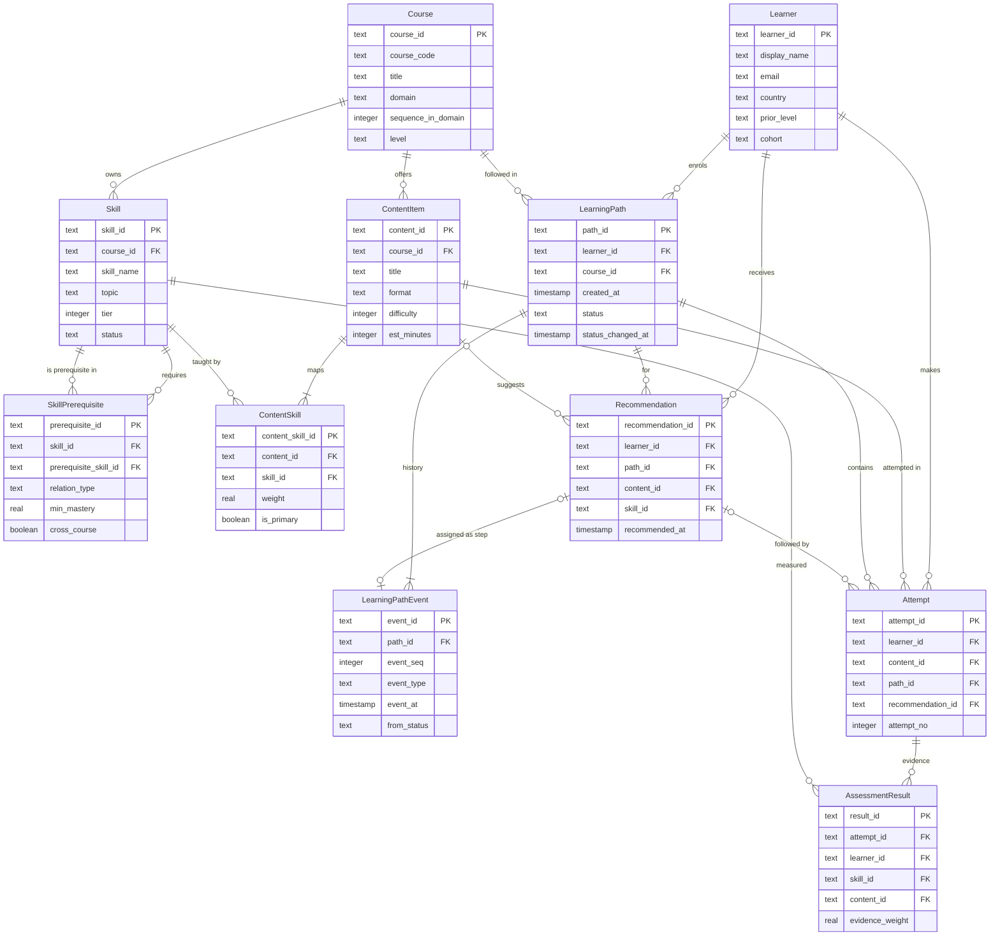

# Entity-relationship diagram

Many-to-many relationships use bridge tables: **ContentSkill** (ContentItem N:M Skill) and **SkillPrerequisite** (Skill N:M Skill, a directed acyclic graph). Optional relationships: `Recommendation.content_id` (null for escalations), `Attempt.recommendation_id`, `Attempt.submitted_at` (abandoned), `Learner.withdrawn_at`, `ContentItem.published_at/retired_at`, `SkillPrerequisite.effective_to`.
